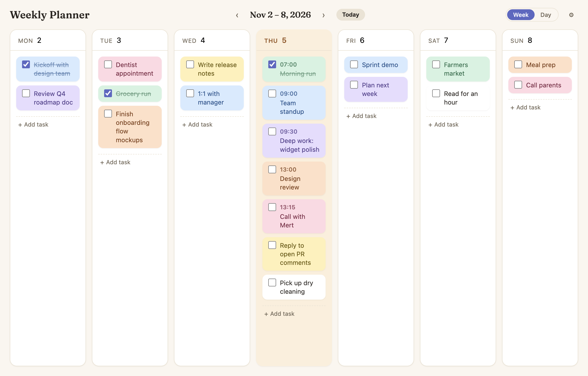
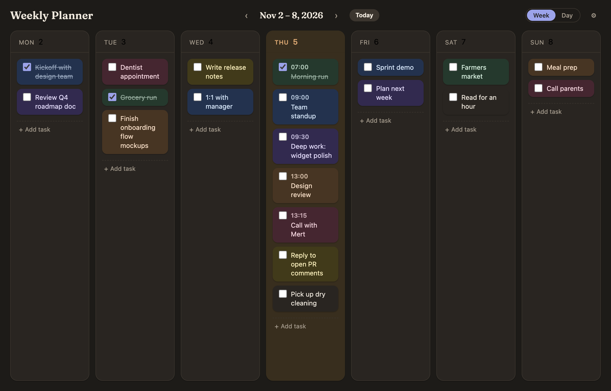
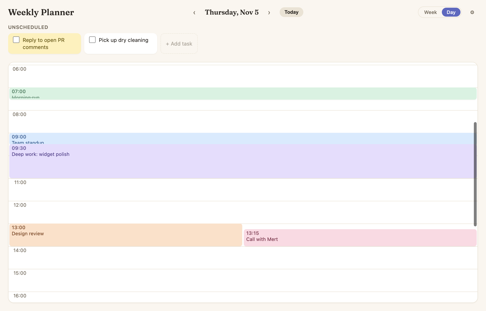
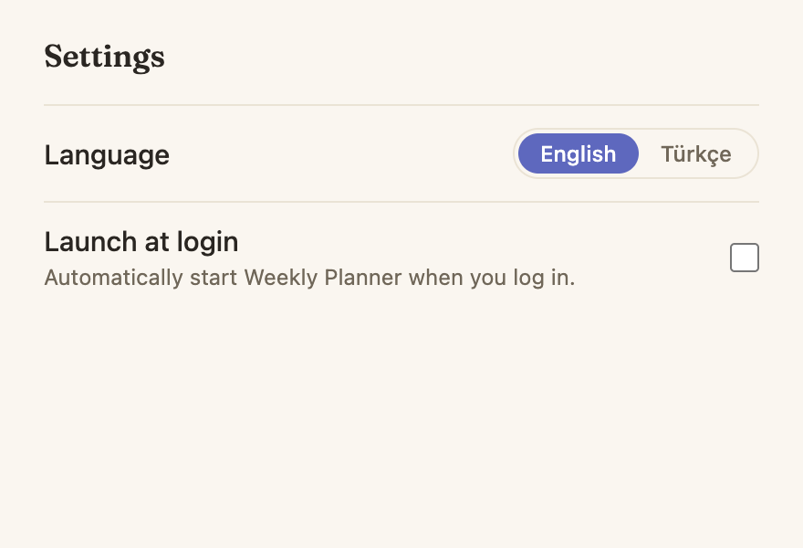
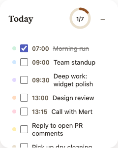

# Weekly Planner

A cross-platform (macOS + Windows) weekly planner desktop app with a small,
pinnable widget that stays in sync with the main window. Fully offline — all
data is stored locally as JSON, no account, no server, no network call.



## Features

- **Week view** — a Monday–Sunday board. Create, edit, complete and delete
  tasks, drag them between days, tag them with one of six pastel color
  labels, and navigate between weeks.
- **Day view with hourly planning** — give any task an optional start time
  and duration and place it on a scrollable 24-hour timeline. Overlapping
  timed tasks lay out side by side, fully visible and clickable, never
  stacked and hidden. A live "now" line marks the current time.
- **Widget** — a small, frameless, always-on-top panel you can pin to any
  screen corner. Shows today's tasks and completion progress, and highlights
  the task that's currently happening or coming up next. Collapses to a
  compact "Today" pill that remembers its state between launches.
- **System tray** — show/hide and collapse/expand the widget, open the main
  window, or quit, all from the tray menu.
- **Launch at login** — optional, toggled from Settings.
- **Light / dark / system theme** — a warm-paper design system with
  WCAG AA–checked contrast in both themes, and full support for
  `prefers-reduced-motion`.
- **English and Turkish**, fully reactive — switching language in Settings
  updates every window and the tray menu immediately, no restart.
- **Offline-first local storage** — tasks and settings live in versioned,
  atomically-written JSON files in the OS's app-data folder. Upgrades run
  through a migration chain; a corrupt file is backed up, never silently
  dropped.

## Screenshots

| Main window (light)                                   | Main window (dark)                                  |
| ----------------------------------------------------- | --------------------------------------------------- |
|  |  |

| Day view with hourly timeline              | Settings                                   |
| ------------------------------------------ | ------------------------------------------ |
|  |  |

| Widget — expanded                                        | Widget — collapsed                                         |
| -------------------------------------------------------- | ---------------------------------------------------------- |
|  |  |

## Download

Prebuilt installers are published on the
[Releases page](https://github.com/iremozgoren/weekly-planner/releases) —
grab the `.dmg` for macOS (universal: Apple Silicon + Intel) or the `.exe`
for Windows.

These are unsigned personal builds, so both operating systems will warn
before the first launch:

**macOS** — Gatekeeper will say the app "cannot be opened because the
developer cannot be verified."
Right-click (or Control-click) the app → **Open** → **Open** again in the
dialog that appears. Or: **System Settings → Privacy & Security**, scroll
down to the blocked-app notice, and click **Open Anyway**. You only need to
do this once.

**Windows** — SmartScreen will show "Windows protected your PC."
Click **More info**, then **Run anyway**.

## Tech stack

- **Electron** — desktop shell (main + preload + renderer processes)
- **electron-vite** — unified Vite build for all three process targets, with HMR in dev
- **React 19** + **TypeScript** (strict) — renderer UI
- **Zustand** — renderer state, always hydrated from and synced to the main process
- **@dnd-kit** — drag-and-drop between days, within a day, and onto the hourly timeline
- **date-fns** — week/day math and locale-aware formatting (English, Turkish)
- **electron-builder** — packages the `.dmg` (macOS) and NSIS `.exe` (Windows)
- Plain **CSS with custom properties** — no CSS framework, no CSS-in-JS runtime

## Architecture

```
┌─────────────────────────── main process ───────────────────────────┐
│ app lifecycle · windows · tray · login item · native theme        │
│ JSON persistence (the ONLY place that touches the filesystem)     │
└───────────────▲─────────────────────────────┬─────────────────────┘
                │ ipcMain.handle (commands)   │ webContents.send (broadcast)
                │                             ▼
┌───────────────┴──────────── preload (contextBridge) ──────────────┐
│ exposes a single typed, allow-listed `window.api` surface          │
└───────────────▲────────────────────────────────────────────────────┘
                │
┌───────────────┴─────────── renderer (React) ──────────────────────┐
│ main window (index.html) · widget window (widget.html)            │
│ Zustand stores · no Node APIs · no fs · no direct ipcRenderer     │
└────────────────────────────────────────────────────────────────────┘
```

The main process is the single source of truth: every task or settings
change is validated and persisted in main, then broadcast to **all** open
windows, which replace their state wholesale from that broadcast. That's
what keeps the widget and the main window in sync — the widget isn't
special-cased, it just listens to the same broadcast. Every window runs with
`nodeIntegration: false`, `contextIsolation: true` and `sandbox: true`.

Tasks and settings are stored as two independent files in the OS's
`userData` directory, each with a `version` field driving a migration
chain, written atomically (`tmp` + rename) and debounced. See
[`CLAUDE.md`](./CLAUDE.md) for the full architecture and conventions.

## Development

```bash
npm install
npm run dev
```

## Commands

| Command             | Description                                                      |
| ------------------- | ---------------------------------------------------------------- |
| `npm run dev`       | Start the app in development mode with HMR                       |
| `npm run typecheck` | Type-check the main/preload and renderer projects                |
| `npm run lint`      | Lint the codebase                                                |
| `npm run format`    | Format the codebase with Prettier                                |
| `npm run build`     | Type-check and build for production                              |
| `npm run build:mac` | Build the macOS `.dmg` installer (run on macOS)                  |
| `npm run build:win` | Build the Windows `.exe` (NSIS) installer (run on Windows or CI) |

CI type-checks and lints every push/PR to `main`; pushing a `v*` tag builds
and publishes both installers to a GitHub Release automatically (see
[`.github/workflows`](.github/workflows)).

## License

[MIT](./LICENSE) © İrem Özgören
